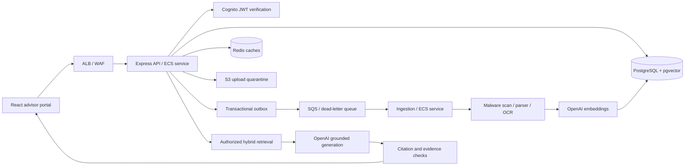

# Architecture and decisions

Status: Original Phase 1 architecture. The approved decisions and implemented Phase 2 changes in [phase-2-decisions.md](phase-2-decisions.md) supersede the assumptions, model dimension, queue, encryption and indexing details below.

## Assumptions requiring product decisions before Phase 2

- A user belongs to one tenant, mapped by verified Cognito subject to the users table. Administrators manage policy documents; advisors read authorized policies. Confirm if users need multiple tenant memberships.
- All advisors initially see their tenant's policies. Add policy ACLs before ingesting documents if visibility must vary within a tenant. Conversation endpoints always require ownership, beyond tenant RLS.
- Document versions are immutable. Effective dates and an explicit query version/as-of date determine applicable terms; upload order alone does not establish legal precedence.
- Choose AWS region/data residency, retention/deletion periods, Cognito federation, OCR languages, upload limits, and compliance requirements before deployment. Proposed upload limit: 25 MiB with a separately governed exception workflow.
- Targets of 1,000 concurrent users, retrieval P95 under 300 ms, answer P95 under 5 seconds, and 99.9% availability are unvalidated goals.

## System shape

Independent API and worker deployment isolates parsing memory spikes, OCR delays, queue retries, and embedding rate limits from chat requests. Workers scale on queue age and backlog per worker; API scales on request load/CPU and connection budgets. An outbox closes the database-commit/SQS-publish gap. SQS provides at-least-once delivery, not exactly-once execution.

## Data and authorization

PostgreSQL owns all durable metadata and history. pgvector avoids a second authorization/index consistency domain. Every tenant-owned relationship uses tenant-aware foreign keys. Row-level security is enabled and forced, and the runtime role is not a superuser, table owner, or BYPASSRLS role. `withTenant` sets tenant context locally inside a transaction so pooled sessions do not leak it. The helper does not authenticate identity; future middleware must resolve it from verified Cognito claims and server-side membership, never an arbitrary request header. Public Phase 1 routes expose no policy records.

Tables: tenants → users and policies → documents → document_versions → document_chunks. Ingestion jobs track leases and generations. Outbox events track pending queue publications. Conversations → chat_messages → retrieval_feedback preserve durable exchanges; audit_logs record metadata only. The executable migration is the source of truth for constraints and indexes. No sample policy data or development login bypass is seeded.

Each document version can contain multiple indexing generations. A worker writes an isolated generation, then atomically activates it and marks COMPLETED. Retrieval must join against that generation and exclude deleted or unauthorized documents. A failed reindex must leave the previous generation searchable. SHA-256 deduplication reuses embedding work within tenant/model scope while retaining each document's citation identity. Generation state publication and cleanup will be implemented in Phase 2.

Vector dimensions are fixed to 1536 in this schema, with a startup guard rejecting mismatched configuration. Changing model dimensions requires a new vector column/index migration and background reindex, followed by cutover; editing an environment variable alone is unsafe. Model identity must also match across query and document embeddings. OpenAI model IDs remain configurable, and no model API calls exist in Phase 1.

## Retrieval and grounding plan

Use parameterized tenant/version/provider-filtered cosine search plus PostgreSQL full-text search. Combine ranks with reciprocal rank fusion, then optionally rerank. HNSW offers good query latency and no training step but consumes substantial index memory and slows writes; IVFFlat uses trained partitions and can be cheaper at the cost of tuning and recall. Benchmark both with realistic tenant skew and metadata filters; filtered ANN search can return too few hits, so evaluate iterative scanning and exact-search fallbacks for small scopes.

Start with heading/table-aware 650-token chunks, 90-token overlap, and a fixed context token budget. Smaller chunks improve specificity but can separate exclusions from conditions. Larger chunks preserve clauses but spend more context on irrelevant text. Preserve table headers, units, pages, and row ranges. Legacy DOC/XLS conversion runs in a sandboxed worker with time/memory limits; OCR is asynchronous and must preserve pages. Treat parsed text as untrusted input.

Ordinary questions follow a bounded deterministic pipeline. Introduce LangChain adapters and a LangGraph DAG in later phases for rewrite → intent → authorized retrieval → generation → validation, without open-ended agent loops. OpenAI SDK integration owns timeouts, bounded retry with jitter, usage reporting, and structured response validation.

No prompt can guarantee absence of hallucination. Validate that citations refer to authorized retrieved chunks and evaluate claim support, numbers, conflicts, and abstention separately. Do not invent confidence scores. Stream progress immediately; buffer factual answer text until evidence validation succeeds rather than streaming unsupported claims that cannot be retracted. Retain explicit original-version citations so later policy changes do not silently rewrite past answers.

## Caching and history plan

Cache keys contain tenant, authorization fingerprint, policy/version/generation filters, model, prompt version, and a normalized query hash. Use separate TTLs: embeddings 24h, retrieval 60s, metadata 60s, bounded conversation context 15min; answer caching is initially off. Index publication increments a tenant corpus revision. Every cache hit must obey current authorization/deletion rules. PostgreSQL persists history; Redis loss must not lose messages. Summaries cannot become evidence for factual policy answers.

## Deployment and observability plan

Phase 1 provides local Compose only. Later Terraform will provision private ECS API/worker tasks, RDS, encrypted ElastiCache, S3 quarantine/published prefixes, SQS/DLQ, Cognito, ALB/WAF, KMS, Secrets Manager and least-privilege IAM. Use short-lived task roles and GitHub OIDC; no cloud keys in images. Public ALB terminates TLS. Databases and Redis require verified TLS. Compare NAT cost with S3 gateway and SQS/Secrets/ECR VPC endpoints; external OpenAI access still requires controlled egress.

Pino records request IDs, route templates, timings and status without raw paths, query strings, bodies, or credentials. Phase 7 adds OpenTelemetry spans, Prometheus/Grafana dashboards, CloudWatch alerts, per-model usage/cost accounting, and queue trace propagation. Phase 1 liveness checks the process; readiness checks the migration and both real dependencies with bounded timeouts. Worker readiness means foundation connectivity only, not an ingestion consumer.

## Phase gates

| Phase | Deliverable                                                                 | Exit evidence                                                              |
| ----- | --------------------------------------------------------------------------- | -------------------------------------------------------------------------- |
| 1     | Monorepo, API, React, PostgreSQL/vector, Redis, Compose                     | Type/lint/unit checks, real DB/cache and RLS tests, container smoke checks |
| 2     | Authorized upload, S3/SQS/outbox, scanning/parsing/OCR, chunking/embeddings | PDF indexing, crash/redelivery tests, invalid/malicious files rejected     |
| 3     | Retrieval, cited responses, bounded streaming                               | Upload-to-answer integration, abstention and citation tests                |
| 4     | Hybrid/RRF, optional reranking, conversation memory, LangGraph              | Recall@K, precision, MRR, nDCG and groundedness regressions                |
| 5     | Complete Cognito/RBAC, ACLs, audit, tenant defenses                         | Cross-tenant, conversation-ownership and adversarial tests                 |
| 6     | Terraform/AWS, delivery pipeline, rollback                                  | Staging deploy, restore and rollback drills, security review               |
| 7     | Cache tuning, telemetry, load/cost evaluation                               | Representative corpus/concurrency measurements against targets             |

Authentication and authorization for each new sensitive route must ship with that route in Phase 2/3; Phase 5 is a hardening gate, not permission to expose unsecured earlier endpoints. Do not proceed past an unvalidated phase.

## Primary references consulted

- [Node release lifecycle](https://nodejs.org/en/about/previous-releases): Node 24 runtime line.
- [Vite setup](https://vite.dev/guide/): supported Node runtime requirements.
- [PostgreSQL row security](https://www.postgresql.org/docs/current/ddl-rowsecurity.html): owner/bypass behavior and forced RLS.
- [OpenAI text-embedding-3-small](https://developers.openai.com/api/docs/models/text-embedding-3-small): configurable embedding model candidate; benchmark before production.

Package versions are resolved from npm and locked in package-lock.json. TypeScript 6 is selected because ts-jest currently requires TypeScript <7. Container tags track supported release lines; pin tested image digests in the production deployment phase.
