# Approved MVP decisions and local ingestion architecture

Approved by the user on 8 October 2026. These decisions replace the open assumptions in the Phase 1 architecture document.

| Area          | Decision                                                                                                                                                                                                                    |
| ------------- | --------------------------------------------------------------------------------------------------------------------------------------------------------------------------------------------------------------------------- |
| Membership    | One tenant per user. A later memberships table can separate Cognito identity from tenant-role grants; no multi-tenant identity semantics are introduced now.                                                                |
| Roles         | ADMIN and ADVISOR, enforced from database membership after JWT verification.                                                                                                                                                |
| Policy access | Tenant-wide visibility initially; future policy ACL filtering belongs in the repository layer before retrieval.                                                                                                             |
| Conversations | Owner-only, even inside one tenant. The implemented conversation detail endpoint verifies tenant, owner, and expiry. Generation/history mutations remain Phase 3.                                                           |
| Versions      | Immutable document versions, effective dates, explicit supersession; ambiguous applicability yields 409 VERSION_CLARIFICATION_REQUIRED.                                                                                     |
| Region        | ap-south-1, configurable; no AWS resources have been provisioned.                                                                                                                                                           |
| Retention     | Tenant-configurable document retention, disabled until approved. Conversation retention proposal stored as 90 days per tenant. No deletion scheduler exists. Archive retains all bytes and removes the version from search. |
| Identity      | Local email/password accounts for this approved demonstration; Cognito access-token verification adapter available for later integration. Enterprise SSO deferred.                                                          |
| Formats       | PDF, DOCX, XLSX, UTF-8 CSV. Legacy DOC/XLS are rejected.                                                                                                                                                                    |
| OCR           | English Tesseract fallback for image-only PDF pages.                                                                                                                                                                        |
| Limits        | 25 MiB upload, 100 PDF pages, 50 workbook sheets, 50,000 rows, 200 workbook columns, 64 MiB total ZIP expansion, 4 MiB extracted text, 10,000 chunks. Limits fail explicitly rather than silently truncating documents.     |
| SLOs          | Provisional; no load or availability guarantees.                                                                                                                                                                            |

## Implemented local flow

```mermaid
flowchart LR
  UI[Authenticated React library] --> Reserve[Validate metadata / reserve immutable version]
  Reserve --> Upload[Authenticated binary upload]
  Upload --> Files[AES-256-GCM local object storage]
  Upload --> Complete[Complete upload transaction]
  Complete --> Queue[(PostgreSQL durable jobs)]
  Queue --> Lease[Worker claim / lease / heartbeat]
  Files --> Scan[ClamAV]
  Lease --> Scan
  Scan --> Parse[Poppler + English OCR / DOCX / XLSX / CSV]
  Parse --> Chunk[Heading and row-aware token chunking]
  Chunk --> Embed[Local Ollama embeddings]
  Embed --> Stage[(Encrypted chunks + pgvector staging generation)]
  Stage --> Publish[Atomic active-generation publication]
  Publish --> Search[Authorized effective-version search]
```

The local storage interface is separate from HTTP and processing. Files use random tenant/version object keys, authenticated encryption with the object key as associated data, temporary encrypted files, fsync, and atomic exclusive publication. Identical upload retries succeed; changed bytes cannot replace an existing object.

The local queue is a transactional PostgreSQL adapter, not an SQS emulator. `complete-upload` inserts a durable job and updates document state in one transaction. Multiple workers claim with `FOR UPDATE SKIP LOCKED`. Ninety-second leases are renewed every 20 seconds. Lease tokens fence every index write and publication. Crashed jobs can be reclaimed; three exhausted attempts enter FAILED, a durable failed queue. Operator retries create a new generation, and idempotency keys make reindex request replays safe. Completed embedding batches are retained and reused using tenant/content/model/dimension cache keys.

The public lifecycle is UPLOADED → PROCESSING → INDEXED, with processing failures entering FAILED, explicit retry entering UPLOADED, and administrative archive entering ARCHIVED. PENDING_UPLOAD is a reservation substate. This is a state machine, not a sequence where successfully indexed documents must fail before being archived.

Index publication checks the expected chunk count and activates a complete generation atomically. Failed reindexing preserves the previous active generation. Quarantined files never enter the index. No cleanup job deletes older generations or sources in this phase. Supersession remains effective after a successor expires or is archived: neither operation implicitly rolls policy terms back to an older version.

## Evidence/version rules

Before query embedding, resolve tenant membership, policy access, document effective dates, and transitive supersession. A failed or unindexed newer applicable version produces APPLICABLE_VERSION_NOT_INDEXED; it never falls back to older policy text. Unresolved overlapping versions require an explicit selection. An explicit version ID is an intentional historical query and still must belong to the authorized policy/tenant and must not be archived.

After embedding, acquire locks and repeat applicability checks so concurrent upload completion, archive, or index publication cannot silently change the evidence set. Every vector query has explicit tenant/model/dimension/version filters in addition to forced database RLS. Search returns excerpts and source metadata only, not a generated policy answer. Distinct documents can contain conflicting terms; conflict-aware generated answers remain Phase 3 work.

`nomic-embed-text:v1.5` produces real local 768-dimensional vectors. Query/document prefixes are applied appropriately. OpenAI embeddings are a configurable adapter at 1536 dimensions, not used in this demonstration. Switching profiles requires reindexing; queries reject a mismatched active profile. Changing Ollama weights behind an existing tag requires a new model tag/profile and reindex. Container image digests are pinned for Ollama and ClamAV; model tags and the observed model digest are recorded in validation evidence when available.

## Security and privacy boundaries

- API and worker use separate non-owner, NOBYPASSRLS database roles. Only the worker can claim jobs; only the API can invoke the narrow identity lookup functions. Worker containers do not receive the session signing key.
- Passwords use salted scrypt. Local tokens are HS256 with a fixed issuer/audience and expiration; local sign-in is disabled in production. HttpOnly, SameSite=Strict cookies, origin checks, server-side membership lookup, and role checks protect the browser flow. Rate limits are per API process for this single-local-instance MVP; distributed limits precede horizontal deployment.
- Authenticated binary uploads verify actual size, SHA-256, declared MIME/extension, file signatures, Office archive limits, and required internal parts. ClamAV failures fail closed. Parsing runs in a bounded worker thread; native extraction/OCR subprocesses have deadlines. Plaintext temporary PDF files exist only on container tmpfs and are removed in finally blocks.
- Uploaded files and extracted chunk text/source metadata are encrypted with AES-256-GCM. Policy names, filenames, identity metadata, hashes, and embeddings remain queryable in PostgreSQL, so host/Docker-volume encryption is required for full disk-at-rest protection. Host encryption could not be confirmed automatically in this session. This is a local development boundary, not production encryption certification. Local loopback/Compose traffic is HTTP; TLS, managed encrypted volumes, backups, key rotation, and secrets infrastructure are production prerequisites.
- The encrypted-text design deliberately removes the Phase 1 plaintext full-text index. Keyword/hybrid retrieval in Phase 4 needs an approved encrypted-storage/full-text indexing design; no plaintext policy text is quietly copied into another index.
- Audit events record IDs, actions, and request IDs. Logs omit document content, credentials, filenames, question text, and dependency error payloads. Audit rows are append-only to application roles.
- No arbitrary password registration or tenant selection is exposed. Bootstrap only creates generated local accounts and leaves existing credentials unchanged. Cognito provisioning must map verified subjects to server-managed membership; groups or client-supplied tenant claims do not grant access by themselves.

## LocalStack and AWS gates

Do not deploy AWS production infrastructure yet. After local RAG validation, implement an S3 ObjectStorage adapter and SQS delivery adapter, retaining the database outbox to close the metadata/publish gap. Validate presigned upload checksum/version binding, duplicate SQS delivery, visibility extensions, dead-letter routing, IAM and encryption configuration against LocalStack. The current local disk/queue implementation must not be represented as tested AWS behavior. Cognito and OpenAI adapters are code-level integration boundaries only; cloud credentials were not supplied and live calls were not made.

## References

- [Ollama embedding endpoint](https://docs.ollama.com/api/embed)
- [Nomic embedding model](https://ollama.com/library/nomic-embed-text)
- [AWS JWT verification library](https://github.com/awslabs/aws-jwt-verify)
- [OpenAI embeddings TypeScript API](https://developers.openai.com/api/reference/typescript/resources/embeddings/methods/create)
